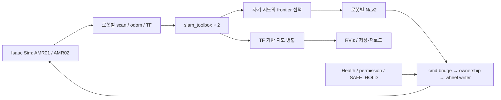

# Gazebo 멀티로봇 구조의 hp_dt / Isaac Sim 이관

기준일: 2026-10-10. 원본 확인 버전: `24c390bd4c4c53b56dd606e8b6528bdd3f14aee5` (`docs: close gazebo multi-robot practice`). 로컬 작업트리와 원격 기본 브랜치 `feat/rviz-two-robots`의 HEAD가 일치하는 것을 확인했다.

## 목적과 종료 경계

Gazebo 프로젝트에서 익힌 두 로봇의 namespace·TF·SLAM·Nav2 연결 구조를 **[hp_dt](https://github.com/Hanseokhyung/hp_dt)**에서 이어간다. 대상은 Isaac Sim의 `amr01`, `amr02`이며, 자동 SLAM → frontier 탐색 → 두 지도 병합 → RViz 표시·저장 순서로 검증한다.

Gazebo에서 확인한 것은 두 로봇과 SLAM·Nav2 활성화, TF 연결, 탐색 목표 전달까지다. 안정적인 자동 주행과 최종 병합 지도 생성·저장은 미완료였다. [2026-10-04 종료 기록](gazebo_multirobot_progress_2026-09-26.md)은 `gz-sim-sensors-system`의 렌더링 thread crash(`Scene already exists`, `OgreScene::InitImpl`, segmentation fault)를 환경 전환의 이유로 남겼다. 이번 확인에서는 당시 crash를 재실행하지 않았다.

## 구조 변경

| 항목 | Gazebo 실습 | hp_dt / Isaac Sim에서 이어가는 방식 |
|---|---|---|
| 로봇 이름·namespace | `robot5`, `robot11`; 설정 파일 각각 작성 | `cfg/amr_fleet.yaml`에서 `amr01`, `amr02` 프로필·토픽·프레임·runtime registry 파생 |
| 센서·odom | Gazebo raw scan → 수동 `ros_gz_bridge`; TF 누락을 odom relay로 보완 | Isaac ROS2 Bridge에서 로봇별 scan·odom·odom TF 생성; 중복 odom relay를 추가하지 않음 |
| 공용 TF | `/robot5/tf`, `/robot11/tf`를 global relay로 전달 | 전역 `/tf`, `/tf_static`에 로봇 이름을 붙인 프레임; robot_state_publisher는 로봇별 하나 |
| 지도 원점 | `world → robot5/map`, `world → robot11/map`의 고정 좌표 | `map → amr01/map`, `map → amr02/map`; 실제 odom 원점 규칙에 따라 현재 fleet 초기 위치에서 파생 |
| SLAM | 로봇별 slam_toolbox + 수동 실행·설정 | 로봇별 slam_toolbox lifecycle 활성화와 센서 범위·프레임·토픽 설정 파생 |
| 자동 탐색 | 외부 `explore_lite`가 Nav2 목표 발행 | 자체 `frontier_explorer` + `amr_explorer`; 도달 가능한 free 경계 셀, 셀별 조건 검사, 목표 예약·실패 기록·제한된 BLOCKED 재평가 |
| 속도·ownership | Nav2 → velocity smoother → collision monitor → TurtleBot4 motion_control → diff drive | Nav2 → cmd bridge → Isaac ownership arbiter → 단일 wheel writer; Health permission·SAFE_HOLD로 제어 경계 유지 |
| 맵 병합 | 외부 `multirobot_map_merge` 설치·구조 검토까지 | 자체 `occupancy_merge` + `amr_map_merge`; 알려진 시작 위치·TF를 이용한 병합, 저장·재로드 비교, 입력 나이 metadata |
| 병합 지도 사용 | 최종 실행 미완료 | 표시·저장용 `/merged_map`; 탐색과 Nav2는 현재 각 로봇의 자기 지도를 사용 |



팀 규칙·원본·보정값, 기존 ownership 계약과 합격 기준은 이관 때문에 변경하지 않는다. Gazebo의 spawn 좌표나 TurtleBot4 제어 체인을 Isaac 설정에 그대로 복사하지 않는다. `explore_lite`와 `multirobot_map_merge`는 비교할 수 있는 참조 구현이며, 이번에 제품 실행 경로에 연결한 패키지가 아니다.

## 그대로 가져오면 맞지 않는 부분

1. `support.launch.py`와 TF relay의 구독 목록은 `robot5/robot11`로 고정되어 있다. 현재 AMR 이름과 좌표에 맞게 파생해야 하며, 이미 Isaac이 발행하는 odom TF와 relay를 동시에 발행하면 안 된다.
2. 저장소 밖 `~/turtlebot4_ws/src/m-explore-ros2`의 `map_merge/config/params.yaml`은 `known_init_poses: true`이고 `/robot1`, `/robot2`의 초기 위치만 담고 있다. `getInitPose()`는 로봇별 x/y/z/yaw 네 값을 요구하므로 이 기본 설정에는 `robot5/robot11` 값이 없다. 이는 현재 파일의 설정 불일치이며, 당시 최종 실패 원인을 새로 재현한 결과는 아니다.
3. 예전 자동 탐색·병합의 C++ 구현과 OccupancyGrid QoS 수정은 별도 워크스페이스에 있다. 이 저장소만 복사하면 실행 의존성과 수정 내역이 함께 전달되지 않는다.
4. 짧은 센서 범위는 시뮬레이터의 raw 값·무반환 처리까지 확인해야 한다. Gazebo의 짧은 RPLIDAR 설정이나 목표 전달 성공을 Isaac의 2 m SLAM·주행 성공으로 간주하지 않는다.

저장된 `two_robots.rviz`에는 TF·RobotModel 둘·LaserScan 둘이 있고 Map 클래스가 없다. 종료 기록의 Map 구성 주장은 저장 파일로 확인되지 않는다. 실행 중 수동으로 추가했는지는 미확인이다.

외부 탐색기 설치 파일의 수정 시각은 `2026-09-26 00:30:31 +0900`, QoS 수정 소스는 `00:26:59`다. 따라서 “8월 31일 설치 바이너리라 수정이 미반영됐다”는 단정은 현재 파일 시각과 맞지 않는다. 시각만으로 수정 포함 여부를 증명할 수도 없으므로 실제 실행 endpoint QoS는 미검증으로 둔다.

## 2026-10-10 이관 경계 검증

Codex가 사용자의 요청으로 hp_dt에서 독립 실행했다. 실제 ROS 메시지 클래스를 사용해 복사한 Python callback 본문을 실행했고, 발행 대상은 메시지 수집 객체로 대체했다. ROS 노드·DDS·Nav2·Isaac은 시작하지 않았다.

| 검증 | 결과·한계 |
|---|---|
| 참조 사본·출처 | 파일 24개 복사, 원본·사본 SHA256 일치. 이 저장소 14개 + 외부 m-explore-ros2 10개 |
| odom / TF callback | stamp·부모·자식·위치·회전 보존, 이름 prefix 정규화, 원본 메시지 불변, static/dynamic 전달 구분, self-loop 제거 |
| 현재 설정과 연결 | 두 AMR 프레임·scan·자기 costmap 지도 일치; 현재 초기 위치에서 병합 참조 파라미터 파생 |
| 합성 지도 | 변환한 두 로봇의 장애물 보존, 병합 저장·재로드 셀·origin·resolution 일치 |
| 탐색 경계 | 현재 frontier 구현에서 도달 가능한 free 목표와 예약 거리 검사 |
| 라이다 설정 | full/video 프로필의 센서·SLAM 최대 거리 일치; 실제 2 m 센서 동작을 검증한 항목은 아님 |

**이관 경계 검사 23/23 PASS**, hp_dt 코드 해시 `60d56da6b2d19d31`. 기본 설정 그대로의 호환 판정은 실패이며, 수정한 참조 설정은 운영 launch와 분리했다. C++ `explore_lite`·`multirobot_map_merge` 실행, SLAM pose 정확도·Nav2 실제 계획·물리 주행은 이번 검사의 범위 밖이다. 직접 실험이므로 regression ledger run id는 없다.

hp_dt 작업트리의 재현 파일:

- `docs/experiments/verify_gazebo_multirobot_transfer.py`
- `var/tmp/gazebo_multirobot_reference/PROVENANCE.json`: 출처 HEAD, dirty 상태, 24개 파일 SHA256
- `var/tmp/gazebo_multirobot_reference/RESULT.json`: 23개 검사, 당시 코드 해시, 검증 스크립트 SHA256, 미검증 범위
- 같은 폴더의 `snapshot/`, `adapted_reference_only/`, 합성 병합 지도

원본 이력은 이 저장소 `24c390bd…`, 외부 구현은 `326cf8a0b487c34246bb8f3326afbcd69576dc60`다. 외부 구현의 `explore/config/params.yaml`, `explore/src/costmap_client.cpp`는 로컬 수정 상태였으며 provenance에 표시했다. 참조 사본은 git에서 제외하고, 검사 코드·기록은 hp_dt의 리뷰·커밋 대기 작업트리에 있다.

hp_dt에서의 실행 명령(해당 원본 워크스페이스와 ROS 2 Jazzy 필요):

```bash
source /opt/ros/jazzy/setup.bash
PYTHONDONTWRITEBYTECODE=1 python3 docs/experiments/verify_gazebo_multirobot_transfer.py
```

## 실제 Isaac 시험과 남은 일

다음은 Claude가 실행한 기존 시험을 확인한 것이며, 위 23개 독립 검사에서 새로 얻은 물리 시험 결과가 아니다.

| 범위 | 실제 결과 | run id |
|---|---|---|
| 12 m 자동 탐색 | 같은 코드 해시 `f8da8156ca49db80`에서 두 번 **32/32 PASS** | `20261009-175626-73662`, `20261009-185256-106754` |
| Nav2 | **31/31 PASS**, 같은 해시 | `20261009-184850-103946` |
| RViz 맵 병합·저장 | **48/48 PASS**, 같은 해시; 같은 stamp의 저장·재로드 차이 0/20232 셀 | `20261009-175205-70907` |
| 현재 순수 회귀 시험 | 코드 해시 `60d56da6b2d19d31`에서 L0 **19/19 FRESH** | `20261009-190729`부터 `190901-114370`까지 |

마지막 동작 변경 없는 docstring 수정으로 전체 코드 해시가 바뀌어 Isaac 결과는 현재 ledger상 **STALE**이다. 기존 FAIL·ABORT를 보존했다. 이관 자료·경계 검사 PASS와 제품 전체 완료 판정은 구분한다.

현재 독립 리뷰에서는 구독 해제 실패 뒤 옛 callback의 재설치 간섭, 목표 재발급 전 Health 확인, 정지 지속 시간과 비동기 permission 처리의 보완 항목이 남았다. 오래된 병합 입력의 metadata를 소비하는 경로도 완료 여부를 분리해 확인해야 한다.

2 m 센서는 개선 조건에서도 mapping **40/45 FAIL**, 자동 탐색 **29/32 FAIL**이다. 병원 전체 탐색, 병합 지도 기반 costmap, 장시간 운행 완료를 주장하지 않는다. 다음 단계는 기존 12 m 메인 시나리오의 리뷰 수정·영향 검증을 마치고, 2 m는 동일 기준의 비교 실험으로 계속 기록하는 것이다.
